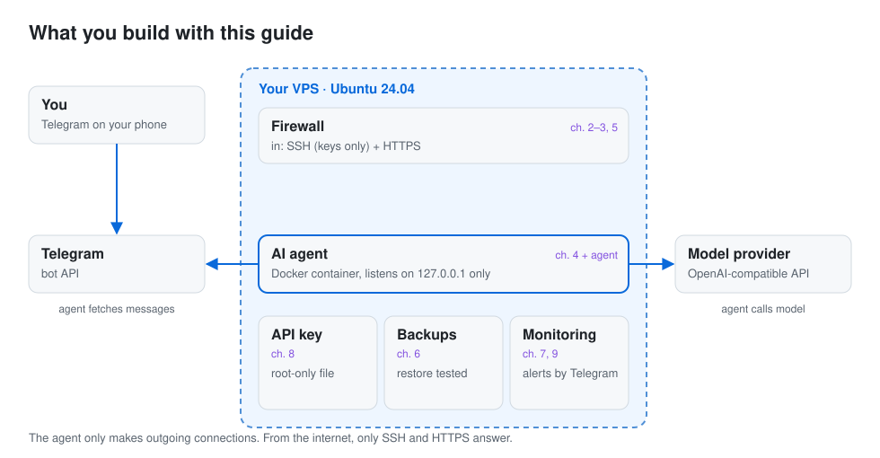

<!-- generated from kandungan/depan/en.md by alat/bina.py: edit the template, not this file -->
# Self-host an AI agent on a VPS

[Bahasa Melayu](README.ms.md)

A step-by-step guide to running your own AI agent, such as Hermes Agent or OpenClaw, on a Linux server you rent and
control, with a Telegram bot as the way you talk to it. Every command in this guide was run on a clean Ubuntu
24.04 machine before it was published, and the record of that run is kept in this repository.

<picture>
  <source media="(prefers-color-scheme: dark)" srcset="kandungan/aset/rajah-en-gelap.svg">
  
</picture>

**Short answer:** rent a small Ubuntu 24.04 VPS with at least 2 GB of RAM, lock
SSH to keys only, turn on the firewall and automatic security updates, install Docker, and run the agent as a container
that only listens on the server itself. Keep the model API key in a file only root can read, talk to the agent through
a Telegram bot, and back up its data in a way you have restored at least once. The chapters below walk through each of
those steps in order.

## Who this is for

- You want an AI agent that runs all day on your own server, not on your laptop.
- You are comfortable copying commands into a terminal, but you do not run servers for a living.
- You want each step explained: what it does, how to check it worked, and how to undo it.

## Chapters

Read the shared chapters in order, then the chapter for your agent. Agent chapters link back to the shared chapters
instead of repeating them. The "Tested on" column is filled in from the test record of each chapter, not typed by hand.

| Chapter | Tested on | Steps run |
|---|---|---|
| [How each command is tested](en/teras/00-contoh.md) | `ubuntu:24.04`, 2026-10-26 | 4 |
| [1. Choose a VPS](en/teras/01-pilih-vps.md) | `ubuntu:24.04` (VM), 2026-10-25 | 4 |
| [2. A user account and SSH keys](en/teras/02-pengguna-ssh.md) | `ubuntu:24.04` (VM), 2026-10-25 | 10 |
| [3. Firewall and automatic updates](en/teras/03-firewall-kemas-kini.md) | `ubuntu:24.04` (VM), 2026-10-25 | 7 |
| [4. Docker, without opening holes in the firewall](en/teras/04-docker.md) | `ubuntu:24.04` (VM), 2026-10-26 | 10 |
| [5. Domain name and HTTPS](en/teras/05-domain-https.md) | `ubuntu:24.04` (VM), 2026-10-25 | 9 |
| [6. Backups you have actually restored](en/teras/06-backup-pulih.md) | `ubuntu:24.04` (VM), 2026-10-26 | 9 |
| [7. A Telegram bot for your server](en/teras/07-telegram.md) | `ubuntu:24.04` (VM), 2026-10-26 | 6 |
| [8. Keeping the model API key out of sight](en/teras/08-kunci-model.md) | `ubuntu:24.04` (VM), 2026-10-26 | 9 |
| [9. Monitoring and updates](en/teras/09-pantau.md) | `ubuntu:24.04` (VM), 2026-10-26 | 8 |
| [Hermes Agent on your server](en/ejen/hermes-agent.md) | `ubuntu:24.04` (VM), 2026-10-26 | 15 |
| [OpenClaw on your server](en/ejen/openclaw.md) | `ubuntu:24.04` (VM), 2026-10-26 | 16 |

Agent versions tested: Hermes Agent v0.22.5, OpenClaw v2026.10.7.

## How the guide is tested

Commands live in step files under `langkah/`. A test runner starts a fresh Ubuntu container, or a full virtual machine
for chapters that touch SSH, the firewall or systemd, and runs every block in order. It writes a record to `bukti/`: the
Ubuntu image and its digest, the date, a checksum of the step file and the exit code of every block. The chapters in
`en/` and `ms/` are generated from the same step files, so the commands you copy are the commands that were tested.
A chapter whose step file changed after its last test run fails the build until it is tested again.

Tests use a stand-in model provider and a stand-in Telegram server, so no real API key or bot token is ever involved.
Firewall and SSH checks are made from outside the virtual machine, the way an attacker on the internet would see them.

## What this guide does not cover

- Prices or recommendations for a specific VPS provider. Chapter 1 lists what to look for and how to check it yourself.
- Running an agent on your own computer or on a managed platform.
- Choosing a model provider. The agent chapters connect to any provider with an OpenAI-compatible API; the agent's own
  documentation covers the others.

## Contributing and security

Fixes and new agent chapters are welcome: see [CONTRIBUTING.md](CONTRIBUTING.md). If you find a step that leaves a
server exposed, please report it privately as described in [SECURITY.md](SECURITY.md). Changes are listed in
[CHANGELOG.md](CHANGELOG.md).

## License

Guide text: CC BY 4.0 ([LICENSE-CONTENT](LICENSE-CONTENT)). Scripts and tools: MIT ([LICENSE](LICENSE)).

## Work with Sasa Teguh

This project is built and maintained by [Sasa Teguh](https://sasateguh.com), a studio in Malaysia. We build websites that are found on Google and in AI answers, and we set up systems like this one for businesses.

[Book a call](https://sasateguh.com/book) · hello@sasateguh.com · [More from Sasa Teguh](https://github.com/sasateguh)
