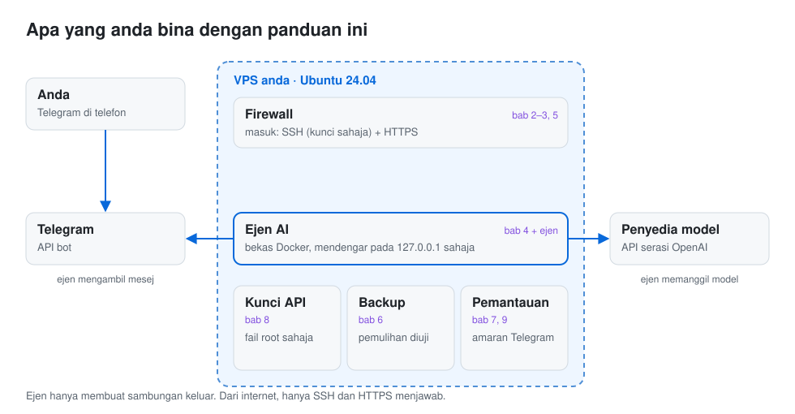

<!-- generated from kandungan/depan/ms.md by alat/bina.py: edit the template, not this file -->
# Pasang ejen AI sendiri di VPS

[English](README.md)

Panduan langkah demi langkah untuk menjalankan ejen AI anda sendiri, seperti Hermes Agent atau OpenClaw, di pelayan
Linux yang anda sewa dan kawal, dengan bot Telegram sebagai cara anda bercakap dengannya. Setiap arahan dalam panduan ini
dijalankan dalam mesin Ubuntu 24.04 bersih sebelum diterbitkan, dan rekod larian itu disimpan dalam
repo ini.

<picture>
  <source media="(prefers-color-scheme: dark)" srcset="kandungan/aset/rajah-ms-gelap.svg">
  
</picture>

**Jawapan ringkas:** sewa VPS Ubuntu 24.04 kecil dengan sekurang-kurangnya 2 GB RAM,
kunci SSH supaya hanya menerima kunci, hidupkan firewall dan kemas kini keselamatan automatik, pasang Docker, dan jalankan
ejen sebagai bekas yang hanya mendengar pada pelayan itu sendiri. Simpan kunci API model dalam fail yang hanya boleh
dibaca root, bercakap dengan ejen melalui bot Telegram, dan buat backup data dengan cara yang pernah anda pulihkan
sekurang-kurangnya sekali. Bab di bawah menerangkan setiap langkah itu mengikut urutan.

## Untuk siapa

- Anda mahu ejen AI yang berjalan sepanjang hari di pelayan anda sendiri, bukan di komputer riba.
- Anda selesa menyalin arahan ke terminal, tetapi pengurusan pelayan bukan kerja harian anda.
- Anda mahu setiap langkah diterangkan: apa ia buat, cara memastikan ia berjaya, dan cara membatalkannya.

## Bab

Baca bab dikongsi mengikut urutan, kemudian bab untuk ejen anda. Bab ejen memaut kembali ke bab dikongsi, tidak
mengulangnya. Lajur "Diuji pada" diisi daripada rekod ujian setiap bab, bukan ditaip dengan tangan.

| Bab | Diuji pada | Langkah dijalankan |
|---|---|---|
| [Cara setiap arahan diuji](ms/teras/00-contoh.md) | `ubuntu:24.04`, 2026-10-26 | 4 |
| [1. Pilih VPS](ms/teras/01-pilih-vps.md) | `ubuntu:24.04` (VM), 2026-10-25 | 4 |
| [2. Akaun pengguna dan kunci SSH](ms/teras/02-pengguna-ssh.md) | `ubuntu:24.04` (VM), 2026-10-25 | 10 |
| [3. Firewall dan kemas kini automatik](ms/teras/03-firewall-kemas-kini.md) | `ubuntu:24.04` (VM), 2026-10-25 | 7 |
| [4. Docker, tanpa membuka lubang pada firewall](ms/teras/04-docker.md) | `ubuntu:24.04` (VM), 2026-10-26 | 10 |
| [5. Nama domain dan HTTPS](ms/teras/05-domain-https.md) | `ubuntu:24.04` (VM), 2026-10-25 | 9 |
| [6. Backup yang sudah anda pulihkan](ms/teras/06-backup-pulih.md) | `ubuntu:24.04` (VM), 2026-10-26 | 9 |
| [7. Bot Telegram untuk pelayan anda](ms/teras/07-telegram.md) | `ubuntu:24.04` (VM), 2026-10-26 | 6 |
| [8. Menyembunyikan kunci API model](ms/teras/08-kunci-model.md) | `ubuntu:24.04` (VM), 2026-10-26 | 9 |
| [9. Pemantauan dan kemas kini](ms/teras/09-pantau.md) | `ubuntu:24.04` (VM), 2026-10-26 | 8 |
| [Hermes Agent di pelayan anda](ms/ejen/hermes-agent.md) | `ubuntu:24.04` (VM), 2026-10-26 | 15 |
| [OpenClaw di pelayan anda](ms/ejen/openclaw.md) | `ubuntu:24.04` (VM), 2026-10-26 | 16 |

Versi ejen yang diuji: Hermes Agent v0.22.5, OpenClaw v2026.10.7.

## Cara panduan ini diuji

Arahan disimpan dalam fail langkah di bawah `langkah/`. Alat ujian memulakan bekas Ubuntu baharu, atau mesin maya penuh
untuk bab yang menyentuh SSH, firewall atau systemd, dan menjalankan setiap blok mengikut urutan. Ia menulis rekod ke
`bukti/`: imej Ubuntu dan digestnya, tarikh, cincangan fail langkah dan kod keluar setiap blok. Bab dalam `en/` dan `ms/`
dijana daripada fail langkah yang sama, jadi arahan yang anda salin ialah arahan yang telah diuji. Bab yang fail
langkahnya berubah selepas ujian terakhir menggagalkan binaan sehingga ia diuji semula.

Ujian memakai pengganti penyedia model dan pengganti pelayan Telegram, jadi tiada kunci API atau token bot sebenar terlibat.
Semakan firewall dan SSH dibuat dari luar mesin maya, seperti yang dilihat oleh penyerang di internet.

## Apa yang tidak diliputi

- Harga atau cadangan penyedia VPS tertentu. Bab 1 menyenaraikan apa yang perlu dicari dan cara menyemaknya sendiri.
- Menjalankan ejen di komputer anda sendiri atau di platform terurus.
- Memilih penyedia model. Bab ejen menyambung ke mana-mana penyedia dengan API serasi OpenAI; dokumentasi ejen itu
  sendiri menerangkan penyedia lain.

## Sumbangan dan keselamatan

Pembaikan dan bab ejen baharu dialu-alukan: lihat [CONTRIBUTING.ms.md](CONTRIBUTING.ms.md). Jika anda menemui langkah
yang mendedahkan pelayan, sila laporkan secara peribadi seperti dalam [SECURITY.ms.md](SECURITY.ms.md). Perubahan
disenaraikan dalam [CHANGELOG.md](CHANGELOG.md).

## Lesen

Teks panduan: CC BY 4.0 ([LICENSE-CONTENT](LICENSE-CONTENT)). Skrip dan alat: MIT ([LICENSE](LICENSE)).

## Bekerja dengan Sasa Teguh

Projek ini dibina dan diselenggara oleh [Sasa Teguh](https://sasateguh.com), sebuah studio di Malaysia. Kami membina laman web yang ditemui di Google dan dalam jawapan AI, dan kami memasang sistem seperti ini untuk perniagaan.

[Tempah panggilan](https://sasateguh.com/book) · hello@sasateguh.com · [Lagi dari Sasa Teguh](https://github.com/sasateguh)
